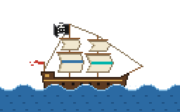

<h1>Niloy Bhattacharjee</h1>

<b>Full stack developer</b> &nbsp;·&nbsp; Sydney 
Mostly backend, data pipelines and simulation, built on AWS with Python and TypeScript.

I got into simulation working with researchers on discrete event models for mining supply chains, and I've kept building in that space since.

 

### Projects

<table>
<tr>
<td width="50%" valign="top">
<b><a href="https://github.com/NiloyBhattacharjee/surgesim">surgesim</a></b> &nbsp;<code>on npm</code> 
Discrete event simulation for cloud and distributed systems.
</td>
<td width="50%" valign="top">
<b>Mitu</b> &nbsp;<code>building</code> 
AI assistant for shops that sell through Facebook, Instagram and WhatsApp DMs.
</td>
</tr>
<tr>
<td width="50%" valign="top">
<b>JaamSim</b> &nbsp;<code>contributing</code> 
Open-source work on the simulator's Event Viewer.
</td>
<td width="50%" valign="top">
<b>ERP</b> &nbsp;<code>learning</code> 
Multi-tenant ERP, starting with an inventory module.
</td>
</tr>
</table>

### Stack

 
Lambda · Glue · SQS · CDK · Bedrock · Transcribe · Snowflake · dbt · SQLAlchemy · Streamlit

<table>
<tr>
<td width="50%" valign="top">
<h3>Before</h3>
Bedrock document analysis for fraud detection 
Font extraction from identity documents 
Entity resolution and inventory models in Snowflake and dbt 
Data and backend work for an energy retailer
</td>
<td width="50%" valign="top">
<h3>Education</h3>
<b>Master of IT (Cyber Security)</b> 
Macquarie University  
<b>BCS (Software Engineering)</b> 
Universiti Teknologi Malaysia
</td>
</tr>
</table>

 

⚓ The ship is redrawn every night from my GitHub activity: masts from lifetime contributions, gunports from repos, wind from the last month, and sails striped with my top languages. <a href="ship.py">How it's drawn</a>.

