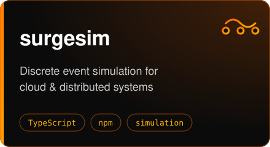
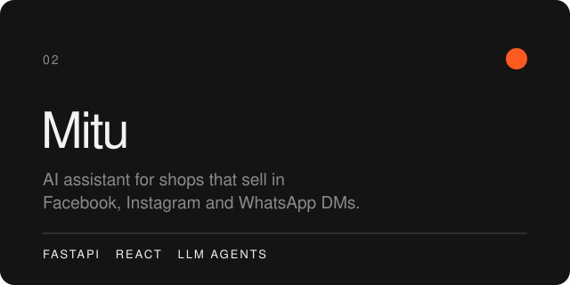
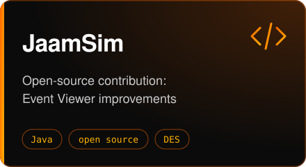
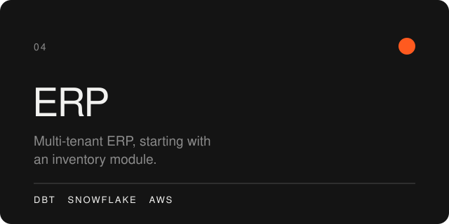

I build backend services, data pipelines and simulation tools, mostly on AWS with Python and TypeScript. I got into simulation working with researchers on discrete event models for mining supply chains.

 

 

 

**Previously**

Bedrock document analysis for fraud detection · Font extraction from identity documents · Entity resolution and inventory models in Snowflake and dbt · Data and backend work for an energy retailer

**Education**

Master of IT (Cyber Security), Macquarie University · BCS (Software Engineering), Universiti Teknologi Malaysia

**Contact**

[LinkedIn](https://www.linkedin.com/in/niloy-bhattacharjee-5b7813153) · niloybhattacharjee99@outlook.com
